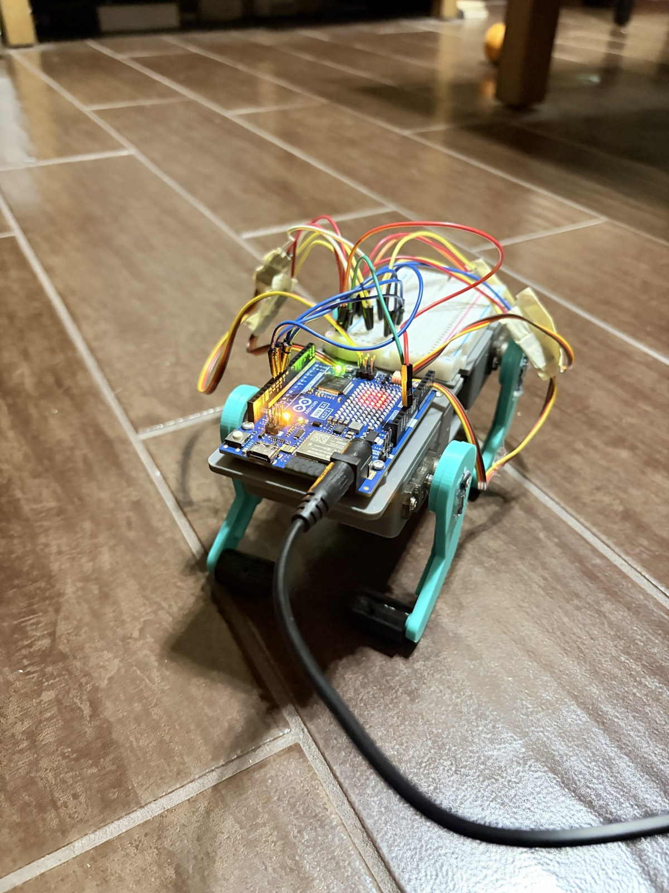
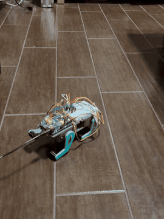
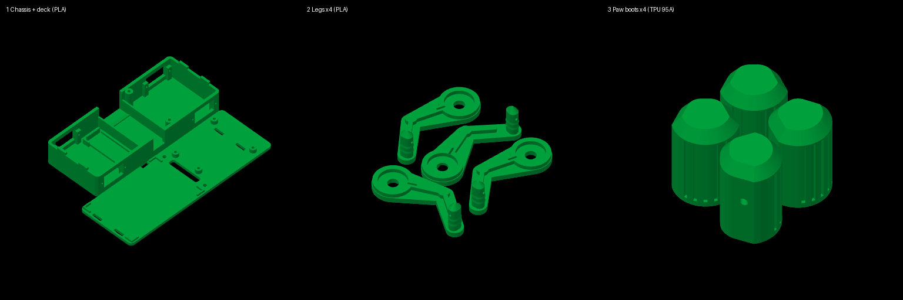
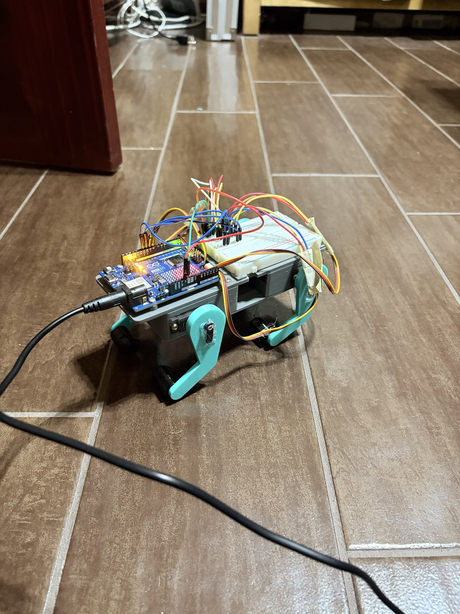

# QuadBot-4: a 4-servo robot dog that does tricks

A small 3D-printed robot dog: four MG90S servos (one hip per leg) on an Arduino UNO R4 WiFi.
It makes its own Wi-Fi network; open a page on your phone and tap a trick.





Full-speed video: [images/tricks.mp4](images/tricks.mp4)

**Tricks:** wave (right or left paw), shake, bark, play bow, sit up, stretch, tail wag, dance, and a demo that runs them all.

> **Walking:** the four-servo gait is not reliable yet, so the phone page has no walking pad.
> The gait code is still in the firmware (joystick remote and serial `w`/`a`/`s`/`d`) for anyone who wants to work on it.

## Parts

| Qty | Part | Notes / link |
|---|---|---|
| 1 | Arduino UNO R4 WiFi (ABX00087) | [docs.arduino.cc/hardware/uno-r4-wifi](https://docs.arduino.cc/hardware/uno-r4-wifi/) |
| 4 | MG90S metal-gear micro servo, 180° | Built with the Miuzei MG90S 5-pack: [amazon.com/dp/B0BWJ2CK9D](https://www.amazon.com/dp/B0BWJ2CK9D). Uses each servo's own single-arm horn and screws. |
| 1 | Half-size solderless breadboard (400 points) | Sits on the deck behind the Uno |
| ~12 | Jumper wires (male-to-male) | Servo plugs to the breadboard and to D8–D11 |
| 1 | Power: USB-C cable, or a 7–12 V DC adapter on the barrel jack | The robot is tethered in this version. A 9 V battery is **not** enough; see [Power](#power-wired-recommended-or-battery-untested) |
| – | Masking tape | To bundle each servo's three wires (see Wiring) |
| optional | 470–1000 µF electrolytic capacitor, 10 V or more | Across the breadboard's 5 V and GND rails; smooths servo current spikes |
| – | PLA, about 108 g | [Bambu PLA Basic](https://us.store.bambulab.com/products/pla-basic-filament) or any PLA |
| – | TPU 95A, about 10 g | For the four paw boots: [Bambu TPU 95A HF](https://us.store.bambulab.com/products/tpu-95a-hf) or any 95A TPU |

## Printing

`print/quadbot4.3mf` is a Bambu Studio project (P1S, 0.4 mm nozzle, 0.20 mm layers, no supports). Slicer estimates:

| Plate | Parts | Material | Time | Filament |
|---|---|---|---|---|
| 1 | Chassis base + deck | PLA, 3 walls, 15 % | 1 h 56 min | 78 g |
| 2 | 4 legs (2 × A, 2 × B) | PLA, 4 walls, 30 % gyroid | 1 h 6 min | 30 g |
| 3 | 4 paw boots | **TPU 95A**, 2 walls, 20 % gyroid | 33 min | 10 g |
| | **Total** | | **≈ 3 h 34 min** | **≈ 118 g** |



- **Servo horn pocket:** each leg holds the servo's single-arm horn in a pocket on its outer face. The pocket runs 21 mm from the hub centre, longer than typical 9 g horns, so horns of different lengths fit without trimming; the hub hole and the tapered sides hold it, and the horn's small screw clamps it. If your horn still doesn't fit well, fix it in the pocket with a dab of hot glue.
- **TPU paw boots:** print from the external spool, not the AMS (TPU 95A HF is not AMS compatible). Dry the spool if it is old. They are push-fit over the barbed ankle bar.
- **A1 mini (180 mm bed):** plates 2 and 3 fit as they are. Plate 1 should fit too, but only just (the deck is 172 mm long); if your slicer complains, print the chassis and the deck on separate plates.
- All STLs are in `stl/`, already oriented for printing.

## Wiring



```
 Arduino UNO R4 WiFi                    Breadboard power rails
   5V  ──────────────────────────────── (+) rail
   GND ──────────────────────────────── (−) rail
                                         optional capacitor: + leg to (+), stripe to (−)
   D11 ── signal ── FRONT-LEFT  servo    red → (+)   brown → (−)
   D10 ── signal ── FRONT-RIGHT servo    red → (+)   brown → (−)
   D9  ── signal ── REAR-LEFT   servo    red → (+)   brown → (−)
   D8  ── signal ── REAR-RIGHT  servo    red → (+)   brown → (−)

 FRONT = the end with the Uno's barrel jack
```

| Servo wire | Goes to |
|---|---|
| Brown | (−) rail = Arduino GND |
| Red | (+) rail = Arduino 5V |
| Orange | signal pin: front-left D11, front-right D10, rear-left D9, rear-right D8 |

- **Bundle each servo first.** The servo plug connects to three jumper wires; wrap each servo's plug-and-jumper joint with a bit of tape so the three wires stay together and don't pull apart when the legs move.
- All grounds are shared: Arduino GND and every brown wire go to the (−) rail.
- **Power note:** all four servos run from the Arduino's 5 V pin. That works for tricks, but four servos moving at once can pull over 1 A. If the board resets or the legs twitch, the supply is sagging: use the barrel jack with a good adapter (or a strong USB-C charger), add the optional capacitor, and start with the gentle tricks (bark, tail wag).
- A0 is the (optional) battery-sense input; leave it empty.

## Power: wired (recommended) or battery (untested)

**Use the wired route for now:** USB-C, or a 7–12 V DC adapter in the Uno's barrel jack, with the servos on the Uno's 5 V pin as shown above.

**About the battery cavity:** the chassis has a cavity sized for a **9 V battery**. A 9 V battery is **not enough** to run this robot. Four servos pull over 1 A in bursts, and a 9 V battery can't deliver that, so the voltage sags and the board resets. Leave the cavity empty, or use it for tidying wires.

**If you want batteries anyway (untested; I have not built or tried this):**
- **Battery:** one **2S LiPo (7.4 V nominal, 8.4 V full)**, a small pack of about 300–500 mAh. Check that it fits in the cavity before buying.
- **Servo power:** an **LM2596S step-down converter** (adjustable, 3 A), for example the [Teyleten LM2596S 5-pack](https://www.amazon.com/dp/B0CPHN7VG1). One converter is enough for four MG90S.
- **Wiring:**
  1. Battery (+) through an on/off switch to the Uno's **VIN** pin (or barrel jack) **and** to the converter's IN+. Battery (−) to Uno GND and the converter's IN−.
  2. **Before connecting any servo**, set the converter's output to **5.0 V** with a multimeter (turn the small brass screw).
  3. Converter OUT+ to the breadboard (+) rail, OUT− to the (−) rail. Every servo plugs in as before.
  4. **Remove the wire from the Uno's 5V pin to the (+) rail.** The servos now get power from the converter, and the two 5 V sources must not be joined. Keep the GND connection between the Uno and the (−) rail.
- **Optional battery gauge:** a 10 kΩ resistor from battery (+) to **A0**, and 4.7 kΩ from A0 to GND. The firmware then shows the voltage and charge on the phone page. It warns at 6.9 V, and at 6.6 V the robot lies down and won't move until the battery is charged. Serial `b` prints the reading; `B 7.95` calibrates it to a multimeter.
- **LiPo safety:** charge only with a balance charger, never leave it charging unattended, don't run it below 6.6 V (3.3 V per cell), and stop using a pack that puffs up.

## Firmware

1. Install the [Arduino IDE](https://www.arduino.cc/en/software), add the **Arduino UNO R4 Boards** package, and install the **ArduinoOTA** library (by Juraj Andrassy) from the Library Manager.
2. Open `firmware/quadbot_r4wifi_robot/quadbot_r4wifi_robot.ino`, pick the board **Arduino UNO R4 WiFi**, and upload over USB.
3. **Change the Wi-Fi password** before you upload: `AP_PASS` and `OTA_PASS` near the top of the sketch (8 characters or more). If you build the joystick remote, set the same password in `ROBOT_PASS` in `firmware/quadbot_r4wifi_remote/`.
4. Before fitting the legs, power the robot once: it puts every servo at its centre (legs straight down). Fit each leg pointing straight down, then fine-tune in calibration (below).

Later updates can go over Wi-Fi (OTA): join the robot's network, then
`curl --data-binary @quadbot_r4wifi_robot.ino.bin http://arduino:<OTA_PASS>@192.168.4.1:65280/sketch`

### Phone page
Join the Wi-Fi network **QuadBot-4** and open **http://192.168.4.1**:
- trick buttons, **demo** (all tricks in turn) and **stop**
- **tap = stand up · hold 1 s = lie down**
- **RESET**: everything stops, all legs straight down
- **leg by leg**: a slider per leg
- **setup**: swap front/back, turn the LED picture

### Serial commands (115200 baud)
| Command | What it does |
|---|---|
| `t1` … `t9` | wave right, wave left, shake, bark, play bow, sit up, stretch, tail wag, dance |
| `t0` | list the tricks |
| `T` | demo on / off |
| `h` | reset: stop, legs straight down |
| `r` | lie down / stand up |
| `k` | leg calibration (`0`–`3` pick a leg, `+`/`-` trim, `f` flip direction, `S` save) |
| `l 4 0` | all legs to 0° (straight down) |
| `F` | swap front / back (saved) |
| `?` | help |

## How the tricks keep their balance

With one hip servo per leg, the legs can only swing fore and aft. Tricks with all four paws down
(bark, play bow, sit up, stretch, tail wag, dance) are stable, with the body's centre 30 mm or more inside the paws.

Lifting one paw is the hard part: with the legs straight down, the centre sits exactly on the line between the two
diagonal paws, so the robot would tip. **Wave** and **shake** therefore first swing all four legs 25° forward,
which slides the body about 25 mm back; the centre is then 13 mm inside the three paws that stay down, and the raised
paw swings 9–24 mm off the floor. If your robot is nose-heavy and tips toward the raised paw, raise `LEAN` to 30 in
`firmware/quadbot_r4wifi_robot/quadbot_tricks.h`. `tools/tricks_balance.py` computes these margins.

## Files

```
firmware/quadbot_r4wifi_robot/    robot sketch (tricks, phone page, OTA, optional battery monitor and 16x2 LCD)
firmware/quadbot_r4wifi_remote/   optional joystick remote (a second UNO R4 WiFi + KY-023 joystick)
cad/                              Python (manifold3d) sources for the legs and paw boots; dog_leg_v2b.py = current legs
stl/                              print-ready STLs
print/quadbot4.3mf                4-plate Bambu Studio project
tools/tricks_balance.py           static balance of each trick pose
```

## Safety

- Servos can pinch fingers; keep fingers out of the legs while it is powered.
- It is a tethered desk robot: don't let it walk off a table.
- Not a toy for small children (small parts).

## License

Code (`firmware/`, `cad/`, `tools/`): [MIT](LICENSE).
3D models (`stl/`, `print/`): [CC BY-NC-SA 4.0](LICENSE-models.md).
